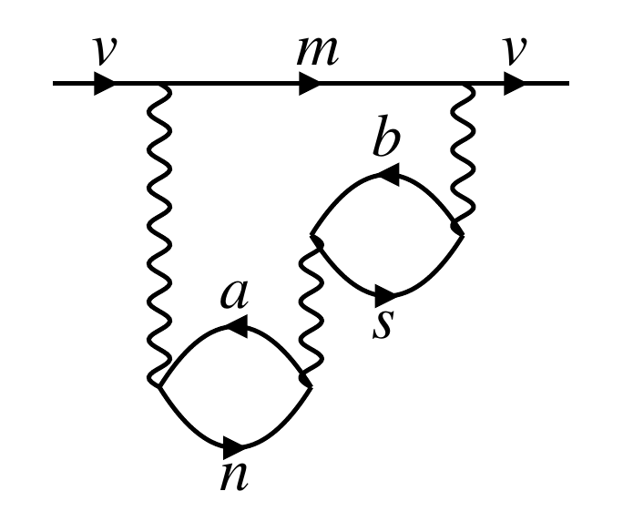
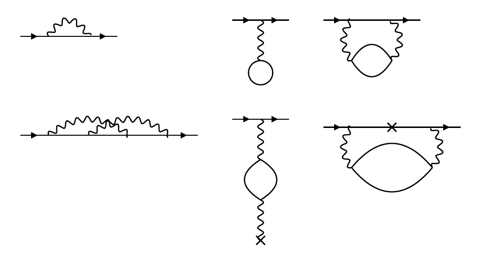
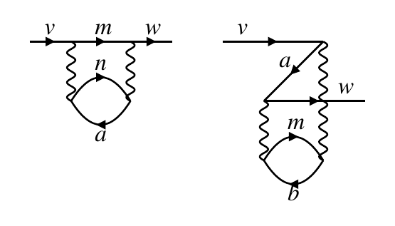
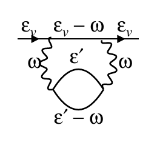

# Goldstoninator

Goldstone and Feynman diagrams for many-body perturbation theory, drawn from a line of text, with the perturbation term that goes with them and its angular reduction. Python 3 and nothing else; Jupyter for the notebooks.

* **Goldstone diagrams** (`goldstoninator.py`) from any product of one- and two-body integrals, `g_vbrs g_asnb t_rm g_mnva`. The time ordering follows from the letters: core `a b c d e f`, valence `v w x y`, excited otherwise.
* **The term**: sign, numerator and energy denominators, as LaTeX source or typeset inline. A one-body vertex absorbs an energy ω, which enters the denominators.
* **Two valence lines**, an effective two-body interaction, with the exchange sign.
* **Antisymmetrised integrals**, `\tilde g_{vamn}` (or `g~_vamn`) for g_vamn − g_vanm: both diagrams, each with its own sign.
* **Feynman diagrams** (`feynmanator.py`) from a product of propagators, `v(1) G(1,2) w(2) Q(1,3) PI(3,4) Q(4,2)`: Green's functions (and their excited or core parts), Coulomb lines (and a second, double-wavy kind), polarisation loops (bare or shaded), external fields. The layout is automatic.
* **Energy labels** on a Feynman diagram, from energy conservation at each vertex.
* **Feynman → Goldstone**: every time ordering of a Feynman diagram as a Goldstone diagram, with the sum of their terms.
* **Several diagrams** side by side, with the sum of their terms.
* **Pictures** inline in Jupyter and as SVG, PDF or TikZ files (a `tikzpicture` to `\input`, or a standalone document). Line styles (wavy, double wavy, dashed, dotted, double, solid), markers (cross, dot, circle, square), picture and label sizes.
* **Angular reduction** (`angularinator.py`) of a Goldstone diagram, a sum of them, or all the time orderings of a Feynman diagram: Coulomb integrals Q^k and W^k = Q^k + P^k, reduced matrix elements, 6j and 9j symbols, phases (the conventions of ampsci). Direct and exchange diagrams merge into W, as does `\tilde g`.
* **External lines**: the m-averaged value with no field, the reduced matrix element with one, S^k of an effective two-body interaction with two valence lines. Several fields in a chain basis along the valence line, or coupled.
* **ampsci C++** for the reduced form, and for the same quantity by brute force over every m: same arguments, same result, so each reduction can be checked in ampsci.

## Examples

For best/full set of examples, see the notebooks:
 * [goldstone_draw.ipynb](./goldstone_draw.ipynb) for Goldstone examples
 * [feynman_draw.ipynb](./feynman_draw.ipynb) for Feynman examples
 * [angular_reduction.ipynb](./angular_reduction.ipynb) for angular reduction examples

### Simple Goldstone demonstration

```python
import goldstoninator as gd

d = gd.diagram("g_vbrs g_asnb t_rm g_mnva")
display(d)
```



```python
# the term as LaTeX, and typeset
print(d.tex())
d.equation()
```

```latex
+\frac{g_{vbrs}\,g_{asnb}\,t_{rm}\,g_{mnva}}{(\varepsilon_{va}-\varepsilon_{mn})(\varepsilon_{vb}-\varepsilon_{ms})(\varepsilon_{vb}-\varepsilon_{rs}+\omega_t)}
```

$$
+\frac{g_{vbrs} g_{asnb} t_{rm} g_{mnva}}{(\varepsilon_{va}-\varepsilon_{mn})(\varepsilon_{vb}-\varepsilon_{ms})(\varepsilon_{vb}-\varepsilon_{rs}+\omega_t)}
$$

### Simple Feynman demonstration

```python
import feynmanator as fd

fd.diagram(["v(1) G(1,2) w(2) Q(1,2)", "v(1) w(1) Qs(1,2) G(2,2)", "v(1) G(1,2) w(2) Q(1,3) PI(3,4) Q(4,2)",
            "v(1) G(1,2) G(2,3) G(3,4) w(4) Q(1,3) Q(2,4)", "v(1) w(1) Qs(1,2) PI(2,3) Qs(3,4) T(4)",
            "v(1) G(1,i) t(i) G(i,2) w(2) Q(1,3) PI(3,6) Q(6,2)"], ncols=3)
```



```python
# its Goldstone diagrams, one per time ordering
g = fd.goldstone("v(1) G(1,2) w(2) Q(1,3) PI(3,4) Q(4,2)")
g
```



```python
# and their sum
print(g.tex())
g.equation()
```

```latex
+\frac{g_{mnva}\,g_{awnm}}{(\varepsilon_{va}-\varepsilon_{mn})}
+\frac{g_{mwba}\,g_{abvm}}{(\varepsilon_{wm}-\varepsilon_{ab})}
```

$$
\begin{aligned}
&+\frac{g_{mnva} g_{awnm}}{(\varepsilon_{va}-\varepsilon_{mn})} \\
&+\frac{g_{mwba} g_{abvm}}{(\varepsilon_{wm}-\varepsilon_{ab})}
\end{aligned}
$$

```python
# with the energy of every line
fd.diagram("v(1) G(1,2) w(2) Q(1,3) PI(3,4) Q(4,2)", energies=True)
```



### Simple angular reduction demonstration

```python
import angularinator as ang

# first-order core polarisation (RPA): the reduced matrix element <w||X||v>
r = ang.angular([r"t_na \tilde g_wavn", r"t_an \tilde g_wnva"])
print(r.tex())
r.equation()
```

```latex
+\sum_{na}\frac{(-1)^{k+w-n}}{[k]}\frac{W^{k}_{wavn}\,\langle n\|t\|a\rangle}{(\varepsilon_a-\varepsilon_n+\omega_t)}
+\sum_{an}\frac{(-1)^{k+w-a}}{[k]}\frac{W^{k}_{wnva}\,\langle a\|t\|n\rangle}{(\varepsilon_a-\varepsilon_n-\omega_t)}
```

$$
\begin{aligned}
&+\sum_{na}\frac{(-1)^{k+w-n}}{[k]}\frac{W^{k}_{wavn} \langle n\|t\|a\rangle}{(\varepsilon_a-\varepsilon_n+\omega_t)} \\
&+\sum_{an}\frac{(-1)^{k+w-a}}{[k]}\frac{W^{k}_{wnva} \langle a\|t\|n\rangle}{(\varepsilon_a-\varepsilon_n-\omega_t)}
\end{aligned}
$$

```python
# or from a diagram: the Feynman diagram above (no field: averaged over m)
fd.diagram("v(1) G(1,2) w(2) Q(1,3) PI(3,4) Q(4,2)").angular()
```

$$
\begin{aligned}
&+\sum_{mna}\sum_{k}\frac{\delta_{j_w j_v}}{[k][w]}\frac{Q^{k}_{mnva} Q^{k}_{awnm}}{(\varepsilon_{va}-\varepsilon_{mn})} \\
&+\sum_{mba}\sum_{k}\frac{\delta_{j_w j_v}}{[k][w]}\frac{Q^{k}_{mwba} Q^{k}_{abvm}}{(\varepsilon_{wm}-\varepsilon_{ab})}
\end{aligned}
$$

```python
# C++ for ampsci: the reduced form, and the same by brute force over every m (to check it)
print(r.ampsci("rpa1"))
print(ang.ampsci_fullmsum([r"t_na \tilde g_wavn", r"t_an \tilde g_wnva"], name="rpa1_fullmsum"))
```
